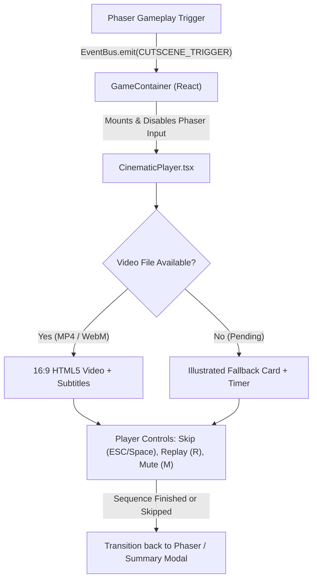

# Google Flow Video Integration Architecture

> **Project**: *Run Titibaccha, Run!*  
> **Document**: Cinematic Video Pipeline & Google Flow Integration Standard  
> **Author**: Technical Game Director & Frontend Architect  
> **Primary Components**: `src/components/CinematicPlayer.tsx` & `src/game/data/CinematicTracks.ts`

---

## 1. Overview & Architecture

*Run Titibaccha, Run!* integrates AI-assisted and hand-crafted narrative sequences generated via **Google Flow** into a smooth, cinematic in-game experience.

The video pipeline is decoupled from the Phaser 3 WebGL/Canvas game engine:
1. When a cutscene or chapter transition occurs, Phaser pauses game physics and dispatches a cutscene event:
   ```typescript
   EventBus.emit(GAME_EVENTS.CUTSCENE_TRIGGER, "chapter1_betrayal");
   ```
2. The React UI host layer displays `CinematicPlayer.tsx`, placing a 16:9 letterboxed presentation screen over the canvas.
3. The player isolates all keyboard and mouse inputs, ensuring Phaser never processes jump or movement inputs during video playback.
4. If a video asset is present in `/public/assets/videos/`, it plays smoothly with synchronized subtitles, persistent audio mute settings, and preloading.
5. If the video is pending or fails to decode in the browser, an animated illustrated and typographic fallback card displays the narrative summary and advances smoothly without stalling the game.
6. Upon completion or skipping, the player cleanly transitions back into Phaser gameplay or opens the chapter completion summary.



---

## 2. Canonical Integration Slots

Five primary cutscene integration slots are established in `src/game/data/CinematicTracks.ts`:

| Slot Key | Scene Title | Chapter Context | Asset Paths | Target Length |
| :--- | :--- | :--- | :--- | :--- |
| `opening_garden` | *Peace in the Garden* | Prologue: Days of Sunshine | `/assets/videos/opening_garden.mp4`<br>`/assets/videos/opening_garden.webm` | 12–15s |
| `meteor_disaster` | *The Shattered Sky* | The Disaster: Garden in Ruins | `/assets/videos/meteor_disaster.mp4`<br>`/assets/videos/meteor_disaster.webm` | 12–16s |
| `chapter1_betrayal`| *The Cunning Deception* | Chapter 1: The Betrayal Climax | `/assets/videos/chapter1_betrayal.mp4`<br>`/assets/videos/chapter1_betrayal.webm` | 18–25s |
| `future_chapter_intro`<br>*(alias: chapter2_intro)* | *Into the Unknown* | Chapter 2: The Search Teaser | `/assets/videos/future_chapter_intro.mp4`<br>`/assets/videos/future_chapter_intro.webm` | 12–15s |
| `final_reunion` | *Together Once More* | Chapter 7: Reunion Epilogue | `/assets/videos/final_reunion.mp4`<br>`/assets/videos/final_reunion.webm` | 15–20s |

---

## 3. Video Pipeline Capabilities

### 3.1 16:9 Cinematic Presentation
Videos and fallback cards are rendered inside a responsive 16:9 container (`aspect-video max-h-[75vh] w-full max-w-5xl rounded-2xl border border-stone-800 bg-stone-950`). The presentation scales gracefully from mobile viewports up to 4K displays with letterboxing where appropriate.

### 3.2 Browser Autoplay Policy Recovery
Modern desktop and mobile browsers enforce strict autoplay policies that reject unmuted `.play()` calls without an earlier user gesture.
`CinematicPlayer.tsx` implements automatic recovery:
1. First attempts playback respecting the player's audio setting.
2. If blocked (`NotAllowedError`), it falls back to muted playback so video progression continues uninterrupted.
3. If muted autoplay is also blocked, an interactive **"Click to Play Cinematic"** overlay button is presented to obtain the required browser user gesture.

### 3.3 Media Preloading
HTML5 video elements specify `preload="auto"` to trigger background progressive buffering as soon as the cutscene trigger is dispatched, minimizing buffering latency on high-resolution videos.

### 3.4 Persistent Audio Settings
The player reads `isMuted` from `SaveSystem.getSettings().muted` and keeps audio playback aligned with the master game sound setting. In addition, players can toggle mute dynamically during video playback by pressing `M` or using the HUD mute button.

### 3.5 Input Isolation
During video playback:
- Phaser keyboard input is completely disabled (`gameRef.current.input.keyboard.enabled = false`).
- React event listeners capture `keydown` and `keyup` with `e.stopPropagation()` in the capture phase.
- Pointer clicks and drag gestures on the cinematic player are stopped from reaching the canvas underneath.

### 3.6 Skip and Replay
- **Skip Sequence**: Click the "Skip" button or press `Escape` / `Space`.
- **Replay Sequence**: Click the "Replay" button or press `R`. Replaying resets `video.currentTime = 0` (or the fallback timer) and re-executes playback from the start.

---

## 4. Google Flow Asset Export Specifications

For optimal desktop browser performance and minimal load times:

- **Dual Delivery Formats**:
  - MP4 (H.264 / AVC)
  - WebM (VP9 or AV1)
- **Container Flag**: Progressive download enabled (`-movflags +faststart` for MP4).
- **Target Resolution**: 1920 × 1080 (1080p, 16:9) or 1280 × 720 (720p, 16:9).
- **Framerate**: 24.0 or 30.0 fps (constant framerate).
- **Color Profile**: YUV 4:2:0, Rec.709 color space.
- **Audio Codec**: AAC-LC (MP4) / Opus (WebM), stereo 48kHz, 160 kbps.
- **Video Bitrate**: 2,500 – 4,000 kbps (CRF 20–22).

### FFmpeg Encoding Command:
```bash
ffmpeg -i google_flow_master.mov \
  -c:v libx264 -crf 21 -preset slow -pix_fmt yuv420p -movflags +faststart \
  -c:a aac -b:a 160k -ar 48000 \
  public/assets/videos/chapter1_betrayal.mp4
```

---

## 5. Adding New Subtitles or Modifying Cues

Subtitles are declared in `src/game/data/CinematicTracks.ts`. Each cue includes:
```typescript
{
  startTime: 0.5,    // Seconds from video start
  endTime: 4.5,      // Seconds from video start
  speaker: "Narrator", // Speaker tag or null
  text: "Innocent and starving, Titi takes a hesitant step toward the fox's bait...",
}
```
The active cue is resolved reactively on every `timeupdate` event and rendered in a stylized, high-contrast semi-transparent pill overlay.
